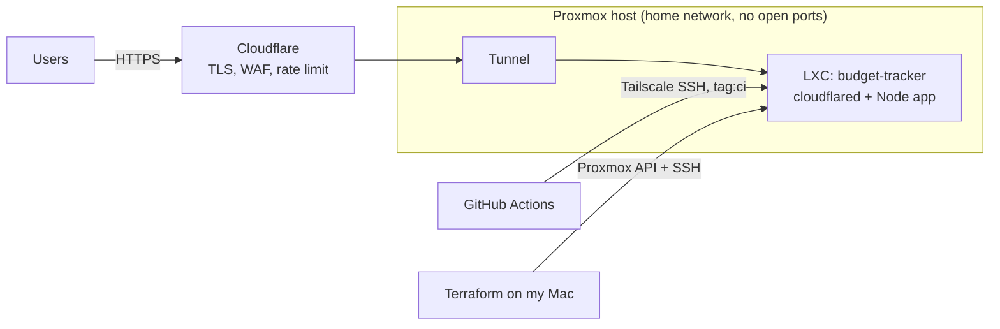

# Homelab

Infrastructure as code for my Proxmox homelab. It builds the servers behind
[budget.atharvvadehra.dev](https://budget.atharvvadehra.dev) and a honeypot research platform, with Terraform, Ansible,
Cloudflare and GitHub Actions. One folder per project, shared pieces in `shared/`.



## What this repository demonstrates

| Skill | Where |
|---|---|
| **Terraform** against Proxmox, Cloudflare and a bootstrap script, with variables, locals, conditional resources and validated inputs | [`projects/budget-tracker`](projects/budget-tracker) |
| **Zero open ports**: Cloudflare Tunnel for publishing, Tailscale SSH for deploys only | [Architecture](docs/ARCHITECTURE.md#networking) |
| **Least privilege**: unprivileged LXC, a `deploy` user that can run one `sudo` command, a CI runner tagged `tag:ci` that can reach one port | [Architecture](docs/ARCHITECTURE.md#access-control) |
| **Safe deploys**: build to a side directory, swap, health check, automatic rollback | [Architecture](docs/ARCHITECTURE.md#deploys) |
| **Secret hygiene in a public repo**: git-ignored state, pre-commit hook, gitleaks in CI, GitHub push protection | [Security](#security-this-repository-is-public) |
| **Ansible and network isolation**: VLAN-separated zones, hypervisor firewalls, hardening roles, a verification playbook | [`projects/honeypot`](projects/honeypot) |
| **Documented trade-offs** and known gaps | [Architecture](docs/ARCHITECTURE.md#known-gaps) |

Read next: **[Architecture and decisions](docs/ARCHITECTURE.md)**. The application itself is in the
[budget-tracker repository](https://github.com/vadehraatharv7-hub/budget-tracker).

## Projects

| Project | What it is | Tools |
|---|---|---|
| [`budget-tracker`](projects/budget-tracker) | Creates an unprivileged Debian LXC, installs Node and the app, publishes it through a Cloudflare Tunnel, sets up CI deploy access and a login rate limit | Terraform (`telmate/proxmox`, `cloudflare`), Bash, systemd |
| [`honeypot`](projects/honeypot) | Two honeypots, a dashboard and a MongoDB database in two isolated network zones | Terraform, Ansible, Proxmox firewall, XDP |

```
Homelab/
├── docs/ARCHITECTURE.md   how it fits together and why
├── projects/
│   ├── honeypot/          Terraform (VMs, ISO, firewall) + Ansible (hardening, services) + deploy.sh
│   └── budget-tracker/    Terraform: unprivileged LXC running the Budget Tracker PWA
└── shared/proxmox/        Proxmox API token every project reads (git-ignored, mode 600)
```

## Security: this repository is public

Only code and examples live here. These stay on your machine and are git-ignored:
`terraform.tfstate*` (state holds generated passwords), `terraform.tfvars`, `credential.auto.tfvars`, `inventory.ini`, `.terraform/`.
Three layers protect against a slip:

1. `.gitignore` excludes them.
2. A pre-commit hook blocks them and runs [gitleaks](https://github.com/gitleaks/gitleaks). Enable it once per clone:
   `git config core.hooksPath .githooks` (and `brew install gitleaks`).
3. GitHub secret scanning with push protection, plus a gitleaks workflow on every push and pull request.

If a secret is ever committed, rotate it first (it is public the moment it is pushed), then clean the history.
Copy `shared/proxmox/credential.auto.tfvars.example` to `credential.auto.tfvars` and fill it in locally.

## Conventions

- **One folder per project** under `projects/`, self-contained: its own Terraform state, `README.md`, `.gitignore`
  and `terraform.tfvars.example`. Nothing in one project reaches into another.
- **Shared secrets live once**, in `shared/`, and projects link to them:
  `ln -s ../../shared/proxmox/credential.auto.tfvars credential.auto.tfvars` (from `projects/<name>/`, or one level
  deeper for a `terraform/` subfolder).
- **Same provider pin everywhere** (`telmate/proxmox 3.0.2-rc10`), so one plugin download serves every project.
- **Never commit** state, `terraform.tfvars`, `credential.auto.tfvars` or `inventory.ini` (the root `.gitignore` covers them).

## Adding a project

```bash
mkdir projects/<name> && cd projects/<name>
ln -s ../../shared/proxmox/credential.auto.tfvars credential.auto.tfvars
# copy providers.tf / variables.tf (pm_api_url, terraform_user, terraform_token, pve_node) from projects/budget-tracker
```

## Quick reference

| Project | Run it | Notes |
|---|---|---|
| honeypot | `cd projects/honeypot && ./deploy.sh` | needs terraform, ansible, go; see its `terraform/README.md` |
| budget-tracker | `cd projects/budget-tracker && terraform init && terraform apply` | see its `README.md` |
