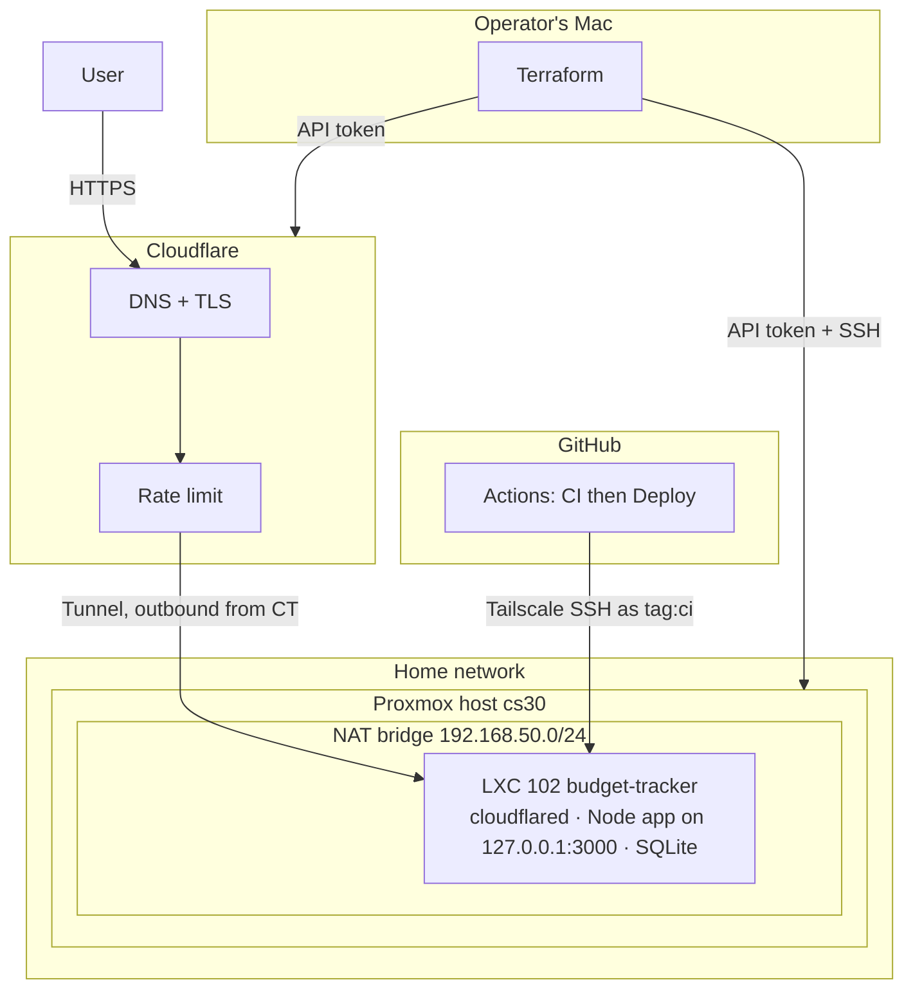

# Architecture and decisions

How the Budget Tracker hosting works, and why it was built this way. The same conventions apply to every project in this
repository.

## Overview

## Networking

- **No inbound ports.** `cloudflared` inside the container opens an outbound tunnel to Cloudflare. Cloudflare serves the
  public hostname and HTTPS, and the home router forwards nothing. This also hides the home IP address.
- **The app binds to `127.0.0.1`.** Only the local tunnel process can reach it, so the container's LAN address exposes
  nothing even if the firewall is wrong.
- **Two paths with two jobs.** Cloudflare publishes the app. Tailscale carries deploys only, so a problem with one does
  not affect the other.
- **A private NAT bridge** (`192.168.50.0/24`) isolates the container from the home LAN. The host's uplink is Wi-Fi, which
  cannot be bridged, so NAT was the practical choice. The cost is that machines outside the host reach the container only
  through the tunnel or Tailscale.

## Access control

| Actor | What it can do |
|---|---|
| Terraform (my Mac) | Proxmox API token scoped to container rights, plus SSH to the host for template download. Reaches the container by jumping through the host (`ssh_via_pve_host`). |
| GitHub Actions runner | Joins the tailnet for the length of the job as `tag:ci` using an OAuth client. The tailnet policy allows `tag:ci` to reach the container on port 22 only, as user `deploy`. No SSH key is stored in GitHub. |
| `deploy` user | No password, no authorised keys. Reachable only through Tailscale SSH, and `sudoers` lets it run a single command, `budget-update`. |
| `budget` user | Runs the app under systemd. It owns the data directory and nothing else. |
| Container | Unprivileged, with nesting enabled only because systemd sandboxing needs it. |

## Deploys

`budget-update <sha>` on the container:

1. Fetches the commit, runs `npm ci` and builds the web app into `dist.next`.
2. Swaps `dist.next` into `dist`, restarts the service.
3. Calls the health endpoint. If it fails, it restores the previous build and the previous commit.

A manual run of the Deploy workflow with an older SHA is the rollback path. The CI pipeline that gates this lives in the
[budget-tracker repository](https://github.com/vadehraatharv7-hub/budget-tracker/blob/main/docs/DEPLOY.md).

## Terraform layout (`projects/budget-tracker`)

| File | Purpose |
|---|---|
| `providers.tf` | `telmate/proxmox` pinned to one version for every project, plus `null`, `random`, `external`, `cloudflare` |
| `variables.tf`, `locals.tf` | Inputs with validation, derived names, feature switches (`cf_enabled`, `access_on`) |
| `template.tf` | Finds and downloads the newest Debian 12 template on the host |
| `lxc.tf` | The container: resources, static IP, key-only SSH, nesting |
| `app.tf` | Copies and runs `scripts/bootstrap.sh` through the host |
| `cloudflare.tf` | Rate-limit ruleset and an optional Access login wall, created only when a Cloudflare token is set |
| `scripts/bootstrap.sh` | Installs Node, creates users and sudoers, writes `budget-update`, installs Tailscale and `cloudflared` |

Conditional resources (`count = local.cf_enabled ? 1 : 0`) mean the stack works with no Cloudflare credentials, then grows
as pieces are added. That is how it was first applied: container first, tunnel and CI access after.

## Secrets in a public repository

The repository is public by choice, because the code is the portfolio. Only code and examples are committed.

| Layer | Control |
|---|---|
| Prevent | `.gitignore` covers `terraform.tfstate*`, `terraform.tfvars`, `credential.auto.tfvars`, `inventory.ini`, `.terraform/` |
| Block locally | `.githooks/pre-commit` refuses those files and runs gitleaks on staged changes |
| Block remotely | GitHub secret scanning with push protection, and a gitleaks workflow on every push and pull request |
| Verify | Full-history scans of both repositories found no secrets |

Terraform state contains generated passwords, so it stays on the operator's machine only.

## Backups

A nightly Proxmox backup job covers the container in `suspend` mode, which directory storage requires. A restore to a
new container ID was run and the app came up with its data.

## Known gaps

- **Backups are on the same disk** as the container. An off-host copy is the next improvement.
- **No Cloudflare Access login wall.** It is written (`enable_access_wall`) and off, because the app has its own login and
  throttling, and Access would complicate the iPhone Shortcuts automation.
- **The edge rate limit is not applied yet.** It needs a narrowly scoped API token (Zone Read, Zone WAF Edit).
- **Terraform state is local.** There is no remote backend, so losing the Mac means importing resources again.
- **Single host.** No high availability. A host failure means restoring from backup.
